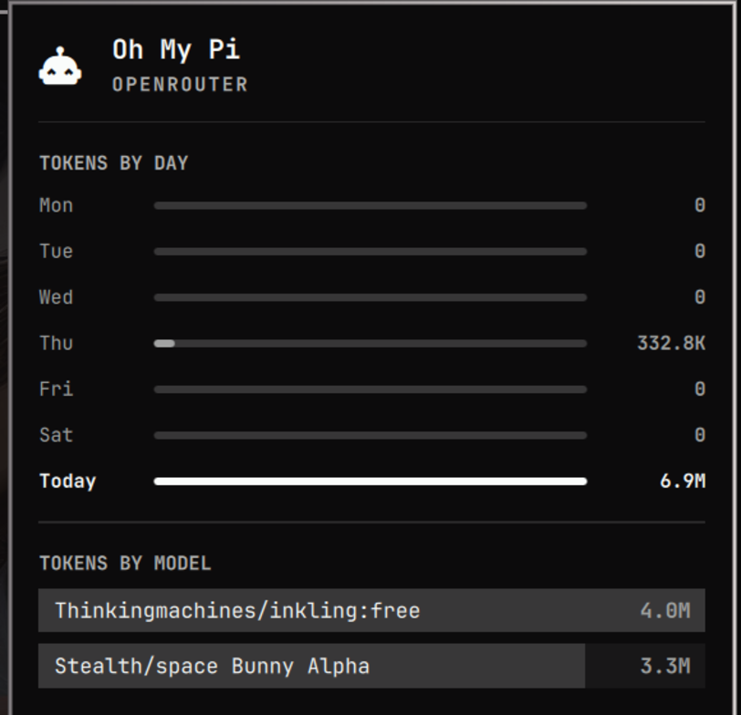

# omarchy-omp-agent-usage

Show [Oh My Pi](https://github.com/can1357/oh-my-pi) token usage in the stock
**Omarchy** `omarchy.agents` bar panel — as an extra "chip" beside Claude,
Codex, and Fireworks.



The first-party agents panel draws every number from JSON records that
`omarchy-agent-usage-update` writes to
`~/.local/state/omarchy/agents/usage/`. Three collectors ship with Omarchy —
`claude`, `codex`, `fireworks` — and each one only counts sessions that ran on
**its own** provider (`provider == "anthropic"`, native Codex session files, the
Fireworks billing API). Traffic from any other provider is filtered out, and
providers without a rate-limit endpoint report no usage at all. Logged into
omp with an OpenRouter key, the panel therefore shows nothing: no chip, no
tokens, no days.

This adds a fourth record with no provider filter, so omp's own sessions show
up as tokens by day and tokens by model, with the same input / output / cache
split on hover that the other chips have.

## Install

```bash
git clone https://github.com/swxkz-omarchy/omarchy-omp-agent-usage.git
cd omarchy-omp-agent-usage
./install.sh
```

Requirements: Omarchy with the Quickshell shell, `python3`, `systemctl`,
`bash`, and an omp that has run at least once (`~/.omp/agent/sessions`
exists). Nothing outside `$HOME` is touched — no packaged file, no plugin, no
sudo.

To refresh every 10 minutes instead of 5:

```bash
OMP_USAGE_REFRESH_SECONDS=600 ./install.sh
```

## Uninstall

```bash
./uninstall.sh
```

## What it installs

| Path | What |
|---|---|
| `~/.local/bin/omarchy-agent-usage-omp` | the collector |
| `~/.config/systemd/user/omp-agent-usage.service` | one-shot run |
| `~/.config/systemd/user/omp-agent-usage.timer` | refresh every 5 min |
| `~/.local/state/omarchy/agents/usage/omp.json` | the record the panel reads |
| `~/.cache/omarchy/agent-usage/omp-sessions.json` | scan cache |

The timer is a **systemd user** unit, so it starts at every login — no
`--now`, no `crontab`, no root. Its first run lands 45 seconds after login;
after that every 5 minutes.

## Manual use

```bash
omarchy-agent-usage-omp            # write the record, print it
omarchy-agent-usage-omp --force    # rescan, ignore the cache
omarchy-agent-usage-omp --print    # print without writing
systemctl --user list-timers omp-agent-usage.timer
```

## How the numbers are counted

Every assistant message in the journals carries
`usage.{input,output,cacheRead,cacheWrite}`; the collector sums those per
model and per day, deduping on the entry id so a resumed or rewound journal
cannot double-count. `.jsonl` and gzipped `.jsonl.gz` archives are both read,
and the full scan of a few hundred sessions takes well under a second.

Token totals **include prompt-cache reads**, matching the Claude and Codex
collectors. `omp stats` prints a smaller "Total Tokens" because it counts
input + output only. With heavy caching (a 92% cache rate is typical) the two
differ by roughly 20x — hover a model row in the panel for the split.

## Limitations

- **No rate limits.** This is local spend, not an account allowance. omp's
  `omp usage` reports nothing for API-key providers such as OpenRouter, and
  this collector does not probe provider endpoints at all. Log in a Codex or
  Claude account and the first-party chips show those limits instead.
- **The panel's refresh button does not cover it.** Pressing `r` runs
  `omarchy-agent-usage-update`, which globs only
  `"$OMARCHY_PATH"/bin/omarchy-agent-usage-*` — first-party collectors in the
  read-only package directory. That is why the timer writes the record itself.
- **Cost is not shown.** The panel contract has no cost field, so the cost
  ledger omp records is dropped.
- Sessions must be local. A machine where omp runs with `PI_CODING_AGENT_DIR`
  or a named profile is resolved the same way omp resolves it, but remote
  agents are out of scope.

## License

MIT. The record format and the collector shape follow Omarchy's own
`omarchy-agent-usage-claude`, which is MIT licensed.
